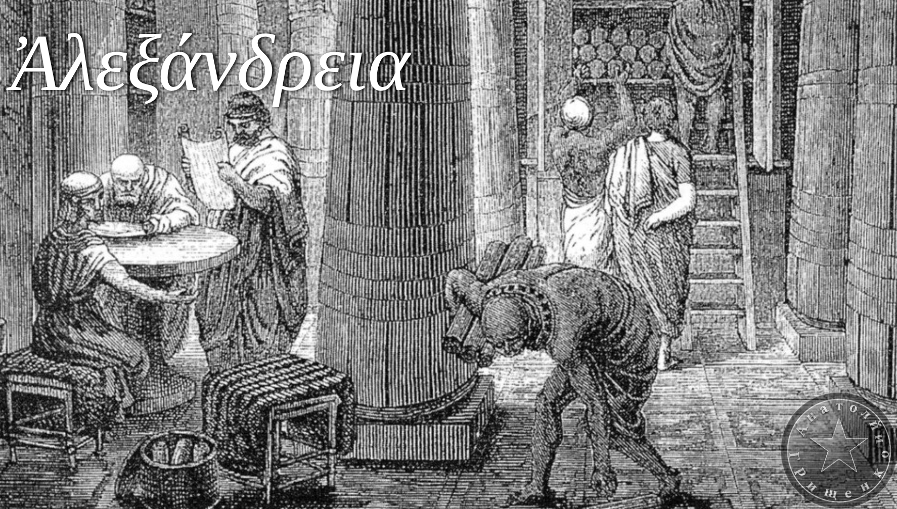 [Image Credits](https://en.wikipedia.org/wiki/Library_of_Alexandria#/media/File:Ancientlibraryalex.jpg)

Welcome to my particular, and very personal, Library of Alexandria. I will leave here EPUBs, PDFs, JPGs, ... whatever publication means is fine to me. I write about my thoughts, my Astrophotography activity, my research on Humanism, code, or whatever I connsider worth sharing. Please feel yourself at home and take whatever you want. Everything is free under Creative Commons Licence. [Leer en Español](./LEEME.md)

# Astropedia Series

My astrophotography activity dressed with some personal thoughts.

| | | | |
| :---: |:---: |:---: |:---: |
|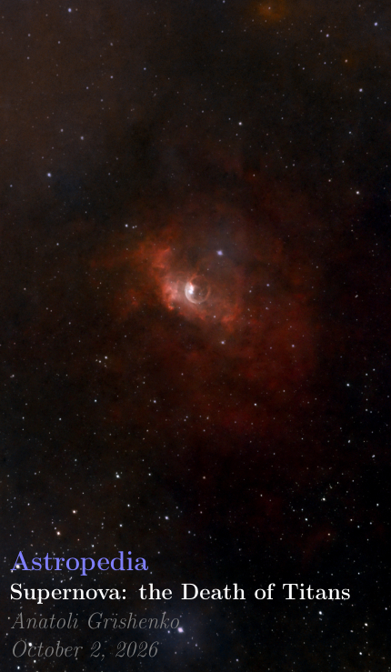 **Supernova: The Death of titans** [Download](https://github.com/Anatoli-Grishenko/Alexandreia/releases/download/The_Shelf/Supernova_US.pdf)  40 Pages. English.|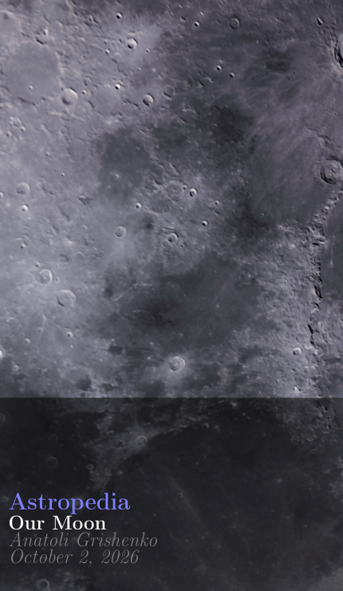 **Our Moon** [Download](https://github.com/Anatoli-Grishenko/Alexandreia/releases/download/The_Shelf/OurMoon_US.pdf)  100 Pages. English.|||

# Sacred Geometry Series

A journey for the history of the human beings which show how its evolution required the development of some sort of algebraic knowledge. Different civilizations, even in opposite sides of Earth, but same algebraic solutions.

## Origins

(AI-generated summary) These three e-books reflect on how mathematics, geometry, and astronomy underpin reality and have guided the development of human civilizations. Through a historical and mathematical lens, they examine the evolution of *Homo sapiens*, highlighting that our most significant distinguishing trait is mutual care and social cohesion in the face of adversity. Furthermore, they explore fundamental concepts such as the "1:2:3" creative principle and sacred geometry, which appear both in the natural world and across various cultures.

| | | | |
| :---: |:---: |:---: |:---: |
|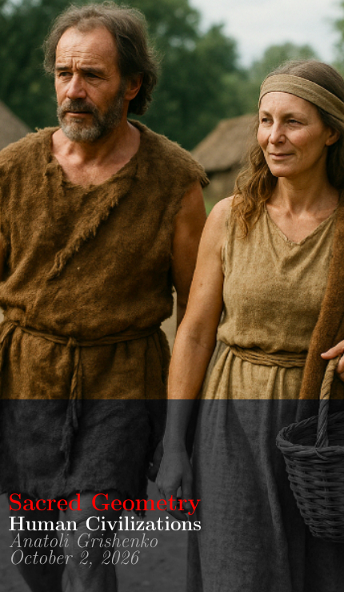 **Human Civilizations** [Download](https://github.com/Anatoli-Grishenko/Alexandreia/releases/download/The_Shelf/Civilizations_US.pdf)  40 Pages. English.|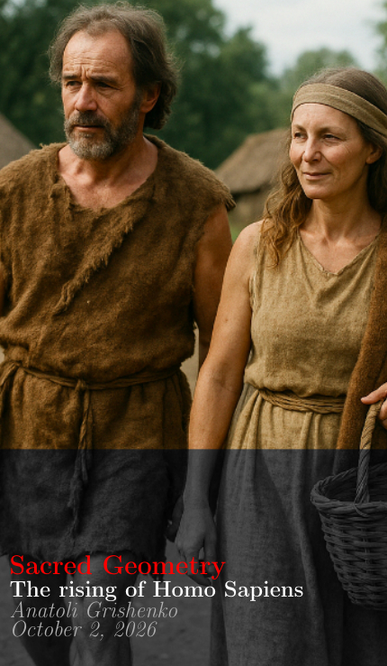 **The Rising of Homo Sapiens** [Download](https://github.com/Anatoli-Grishenko/Alexandreia/releases/download/The_Shelf/RisingSapiens_US.pdf)  34 Pages. English.|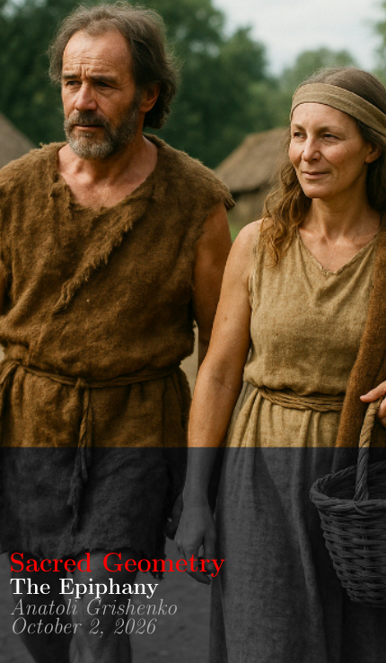 **The Epiphany** [Download](https://github.com/Anatoli-Grishenko/Alexandreia/releases/download/The_Shelf/TheEpiphany_US.pdf)  41 Pages. English.||

## Dynastic Egypt

(AI-generated summary) These three e-books explore how the scribes and priests of ancient Egypt developed practical mathematics and geometry. Drawing on problems from the Rhind Papyrus, the text examines the efficient distribution of food using unit fractions, as well as the measurement of farmland following the flooding of the Nile. Furthermore, it analyzes the creation of the solar calendar and the precision involved in the geometric and astronomical alignment of the Giza pyramids.

| | | | |
| :---: |:---: |:---: |:---: |
|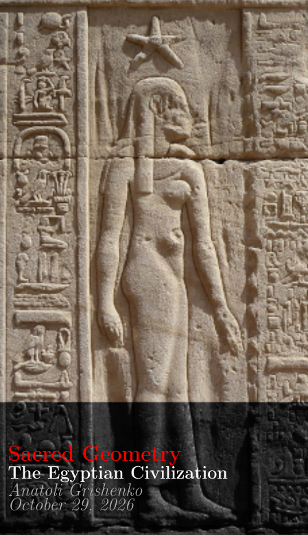 **The Egyptian Civilization** [Download](https://github.com/Anatoli-Grishenko/Alexandreia/releases/download/The_Shelf/Egyptian_Civilization_US_EBook.pdf)  18 Pages. English.|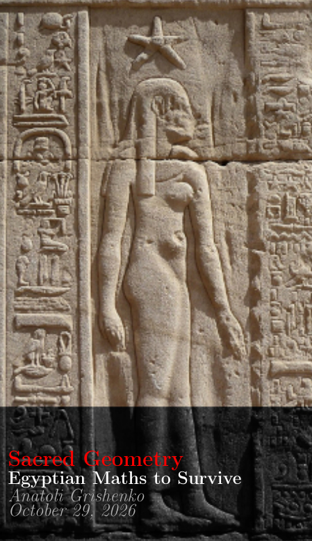 **Egyptian Maths to Survive** [Download](https://github.com/Anatoli-Grishenko/Alexandreia/releases/download/The_Shelf/Egyptian_Maths_US_EBook.pdf)  34 Pages. English.|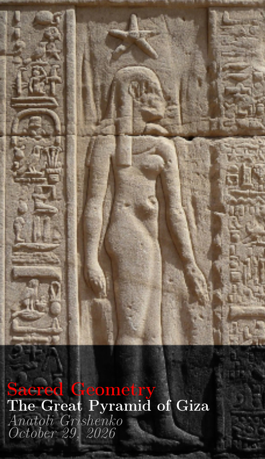 **The Great Pyramid of Giza** [Download](https://github.com/Anatoli-Grishenko/Alexandreia/releases/download/The_Shelf/Egypt_Giza_US_EBook.pdf)  24 Pages. English.||

### Fables Sacred Geometry

Fables are kind of a tiny lecture which transport the reader to an ancient place or time in History in order to provide a proper context for the upcoming episodes of the series.

| | | | |
| :---: |:---: |:---: |:---: |
|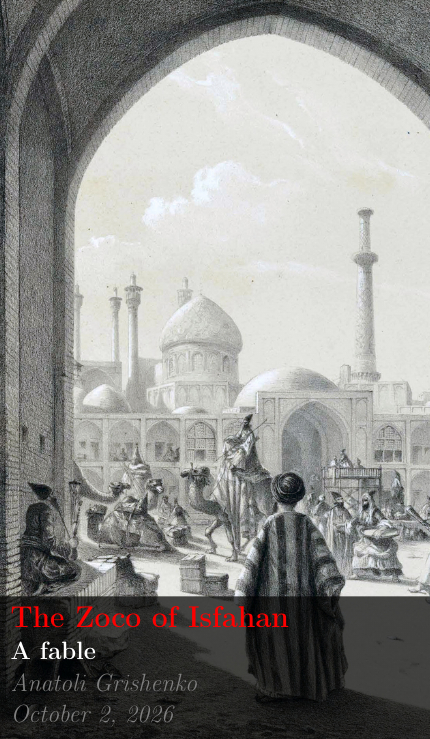 [Download](https://github.com/Anatoli-Grishenko/Alexandreia/releases/download/The_Shelf/Fable_Zoco_Isfahan_US.pdf) **The Zoco of Isfahan**  16 pages English.|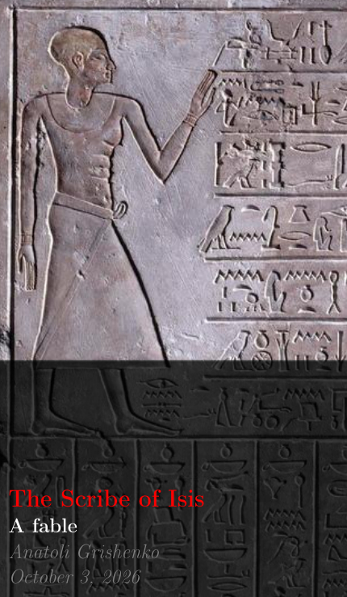 [Download](https://github.com/Anatoli-Grishenko/Alexandreia/releases/download/The_Shelf/FableIsis_US.pdf) **The Temple of Isis**  14 pages English.|||

## Mathematical background

The formulae which describe everything

| | | | |
| :---: |:---: |:---: |:---: |
|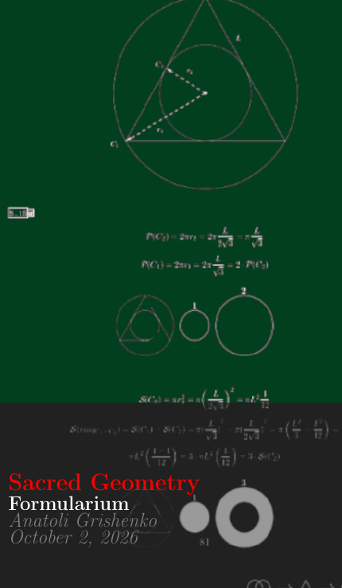 **The Formularium** [Download](https://github.com/Anatoli-Grishenko/Alexandreia/releases/download/The_Shelf/Formularium_US.pdf)  60 Pages. English.||||

# Vídeos

## Unum Et Diversum

| | | | |
| :---: |:---: |:---: |:---: |
|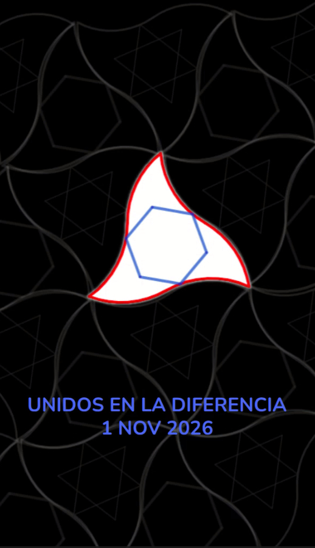 **Día 1. Unum et Diversum** [▶️](https://drive.google.com/file/d/1arXmnsY1fGxm6JAafdlW--1xoCrGCxu9/view?usp=drive_link)  Spanish|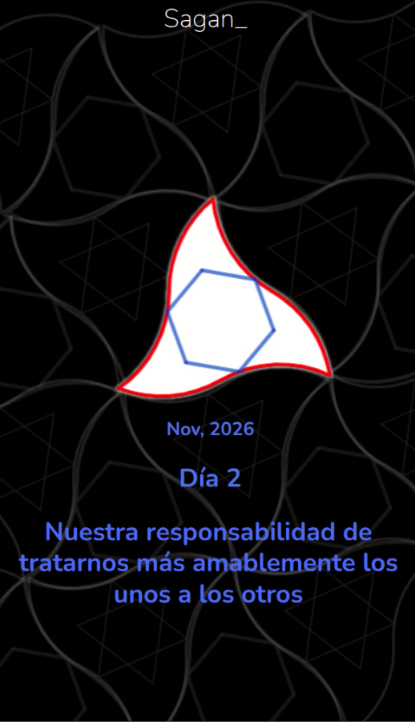 **Día 2. Sagan** [▶️](https://drive.google.com/file/d/18qBg8wvfkLTVBPYKPxgqMdwhKyfTmDQ-/view?usp=drive_link)  Spanish|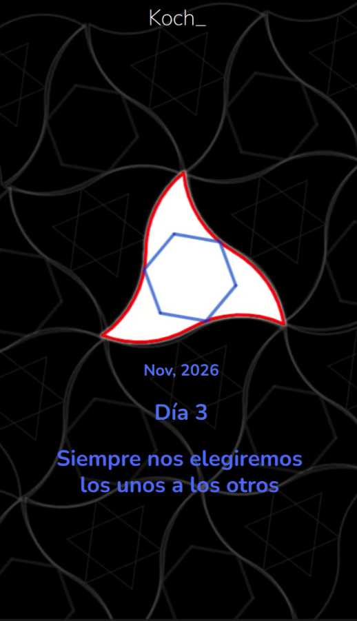 **Día 3. Koch** [▶️](https://drive.google.com/file/d/1pKGhXJPvO-CcD1TUL-9pyFwNzBAPn3ny/view?usp=drive_link)  Spanish|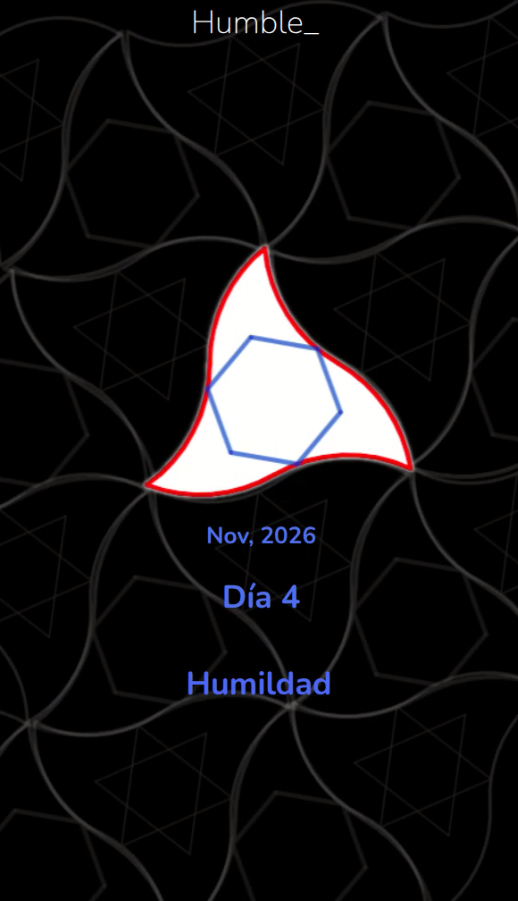 **Día 4. Humildad** [▶️](https://drive.google.com/file/d/1Y-vLPwIJ3t-f_NxhFj5LoBjXrhElQp2-/view?usp=drive_link)  Spanish|
|**Resumen**(IA) Frente a la polarización y la previsible crispación del panorama electoral, este proyecto plantea ir contracorriente para reivindicar aquello que nos une: nuestro origen común, la construcción compartida y la ética de la convivencia.|**Resumen**(IA)  A partir de la histórica fotografía del «Pálido Punto Azul» de la Voyager 1 tomada por impulso de Carl Sagan, este episodio recuerda la pequeñez de nuestra existencia en el cosmos. Subraya la responsabilidad ética ineludible de tratarnos con mayor amabilidad y de cuidar el único hogar compartido que tenemos.|**Resumen**(IA) Basado en el discurso de la astronauta Christina Koch (Premio Princesa de Asturias de la Concordia 2026), el episodio reflexiona sobre la fragilidad de la Tierra vista desde el espacio. Transmite un llamado a la unidad, instando a reconocer que la humanidad comparte una única tripulación y que la plenitud reside en elegir el cuidado mutuo y el triunfo diario del amor.|**Resumen**(IA) A través de la fotografía SMACS 0723 del telescopio espacial James Webb —que captura miles de galaxias en una porción de cielo equivalente a un grano de arena sostenido a la distancia del brazo— el episodio confronta la inmensidad insondable del universo. Frente a esta escala, lanza una reflexión directa sobre la desproporción de nuestra propia soberbia: una invitación a la humildad y a cuestionar cuán importantes nos creemos realmente.|
|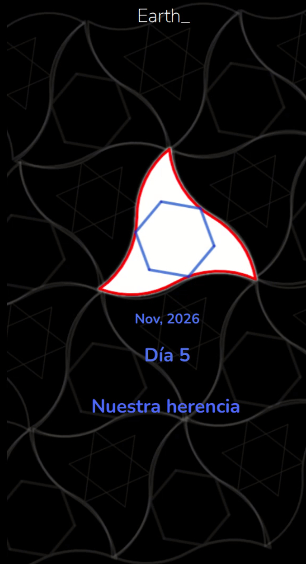 **Día 5. Earth** [▶️](https://drive.google.com/file/d/1QE-zondqh7EF9mxJx4E3kEhpGSolNREB/view?usp=drive_link)  Spanish|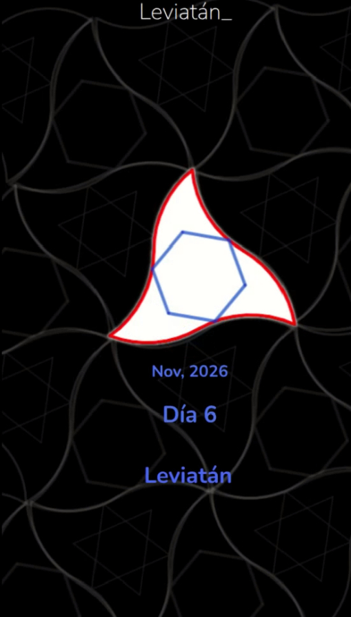 **Día 6. Leviatan** [▶️](https://drive.google.com/file/d/1jHqiIDX4E3-TnQhQDktC9PD42qN-bexm/view?usp=drive_link)  Spanish| **Día 7/1. LUCA** [▶️](https://drive.google.com/file/d/17HuHYeWTszOjRgi8oDXqNy9wXHGLR4Pf/view?usp=drive_link)  Spanish||
|**Resumen**(IA) El episodio traza la historia geológica de la Tierra desde su formación hace 4.500 millones de años hasta el Antropoceno, contrastando la fugacidad de los 30.000 años de dominio humano con la longevidad de cianobacterias y dinosaurios. Concluye con una advertencia sobre el destino inevitable del planeta y la futilidad de la avaricia y la violencia humana ante la escala del tiempo cósmico.|**Resumen**(IA) A partir del evento Carrington de 1859, el episodio ilustra la amenaza de una Eyección de Masa Coronal masiva sobre nuestra red eléctrica contemporánea. Presenta dos futuros posibles: una utopía de cooperación global que evita el colapso, o una distopía de caos y supervivencia donde la avaricia política destruye la civilización.|**Resumen**(IA) Partiendo de la diversidad humana actual para buscar nuestra raíz común, el episodio viaja al universo primigenio de hidrógeno y recorre la forja de estrellas, planetas y caldo prebiótico hasta el surgimiento fortuito pero inevitable de LUCA. La conclusión central es que la vida no es una excepción milagrosa, sino una regla natural y necesaria derivada únicamente de las leyes de la física y la química.||

# A3 Posters Nebulae

| | | |
| :---: |:---: |:---: |
|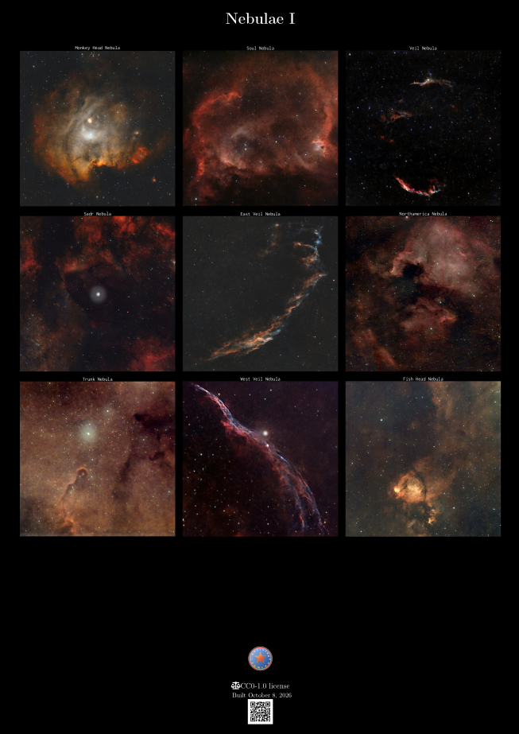 **Nebulae I** [Download](https://github.com/Anatoli-Grishenko/Alexandreia/releases/download/The_Shelf/Nebulae_I_US_A3.pdf)  1 A3-Pages. English.|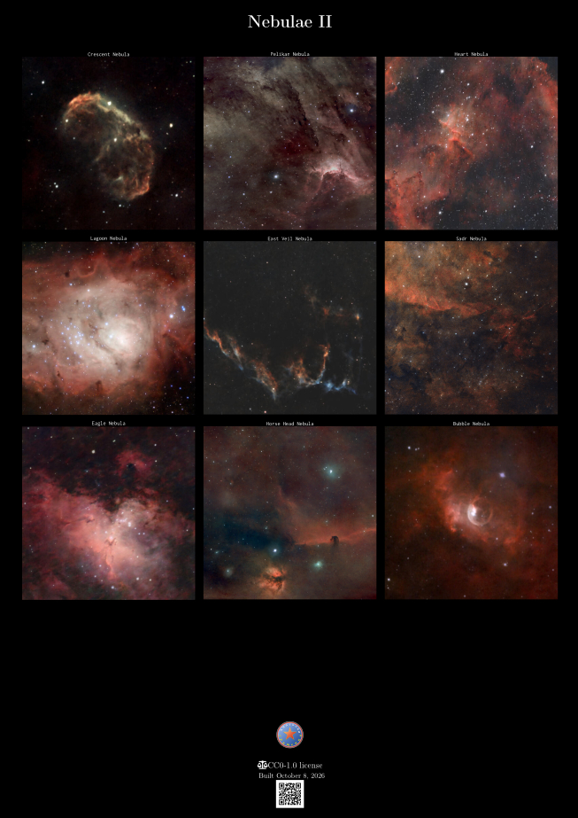 **Nebulae II** [Download](https://github.com/Anatoli-Grishenko/Alexandreia/releases/download/The_Shelf/Nebulae_II_US_A3.pdf)  1 A3-Pages. English.|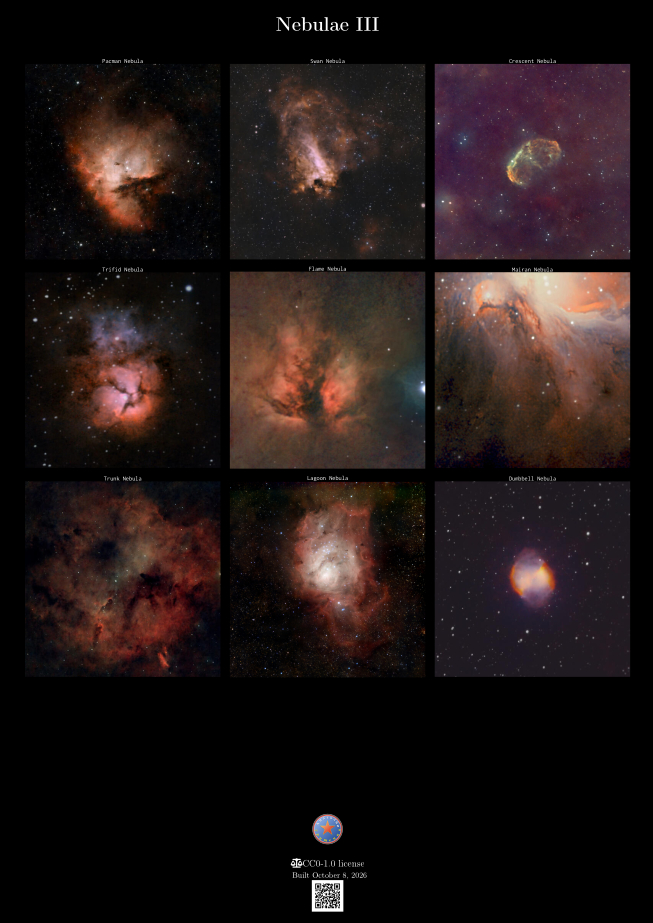 **Nebulae III** [Download](https://github.com/Anatoli-Grishenko/Alexandreia/releases/download/The_Shelf/Nebulae_III_US_A3.pdf)  1 A3-Pages. English.|
|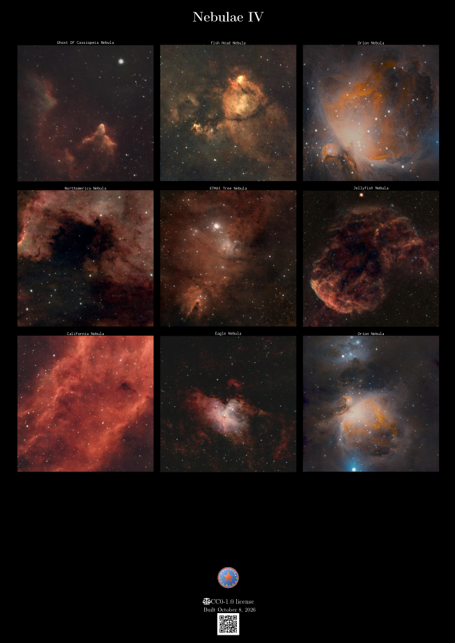 **Nebulae IV** [Download](https://github.com/Anatoli-Grishenko/Alexandreia/releases/download/The_Shelf/Nebulae_IV_US_A3.pdf)  1 A3-Pages. English.|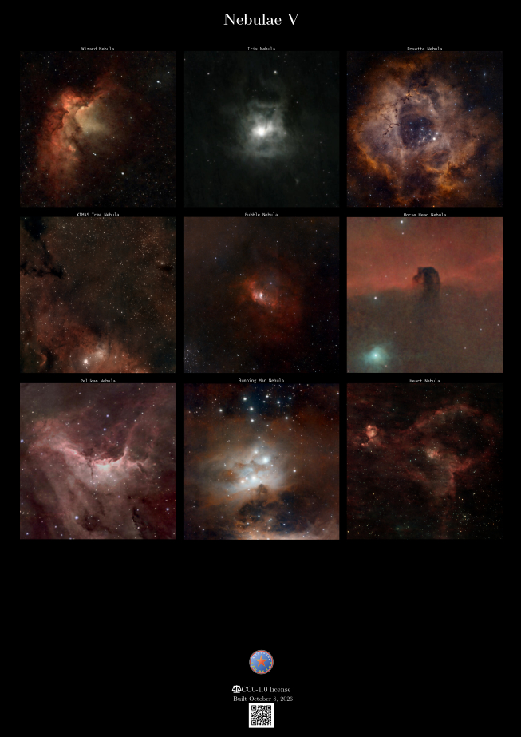 **Nebulae V** [Download](https://github.com/Anatoli-Grishenko/Alexandreia/releases/download/The_Shelf/Nebulae_V_US_A3.pdf)  1 A3-Pages. English.|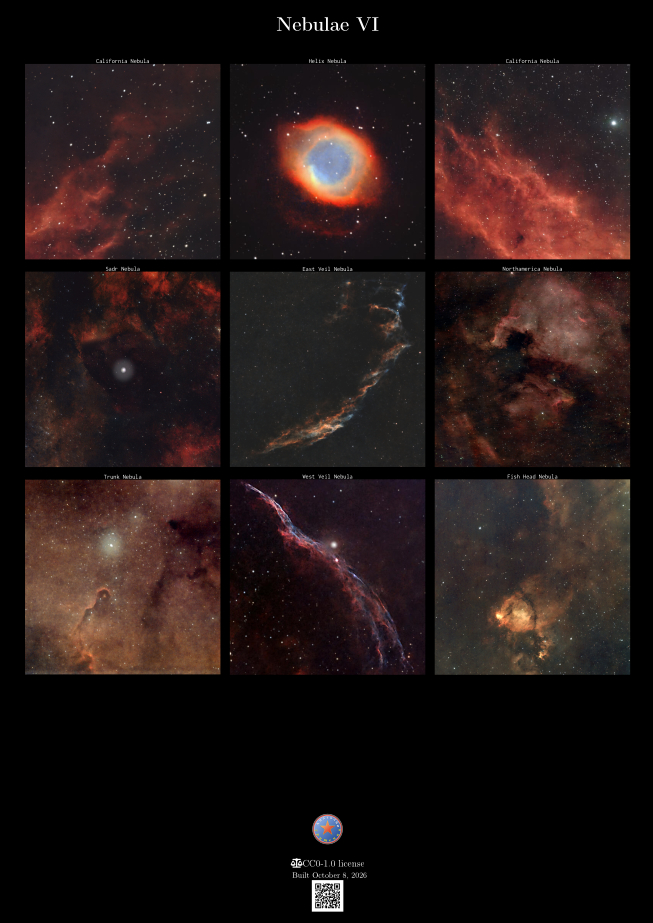 **Nebulae VI** [Download](https://github.com/Anatoli-Grishenko/Alexandreia/releases/download/The_Shelf/Nebulae_VI_US_A3.pdf)  1 A3-Pages. English.|

# A3 Posters Moon

| | | | |
| :---: |:---: |:---: |:---: |
|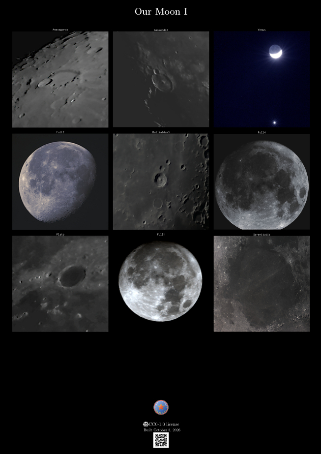 **Moon I** [Download](https://github.com/Anatoli-Grishenko/Alexandreia/releases/download/The_Shelf/Moon_I_US_A3.pdf)  1 A3-Pages. English.|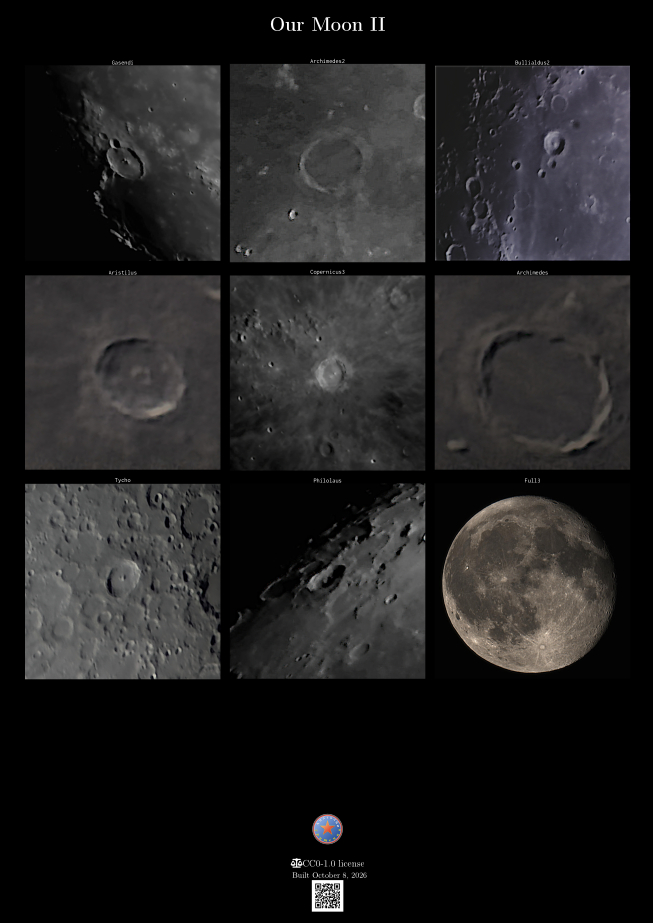 **Moon II** [Download](https://github.com/Anatoli-Grishenko/Alexandreia/releases/download/The_Shelf/Moon_II_US_A3.pdf)  1 A3-Pages. English.|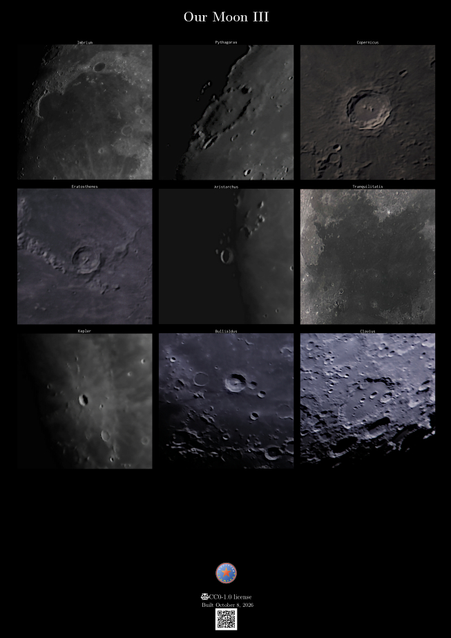 **Moon III** [Download](https://github.com/Anatoli-Grishenko/Alexandreia/releases/download/The_Shelf/Moon_III_US_A3.pdf)  1 A3-Pages. English.|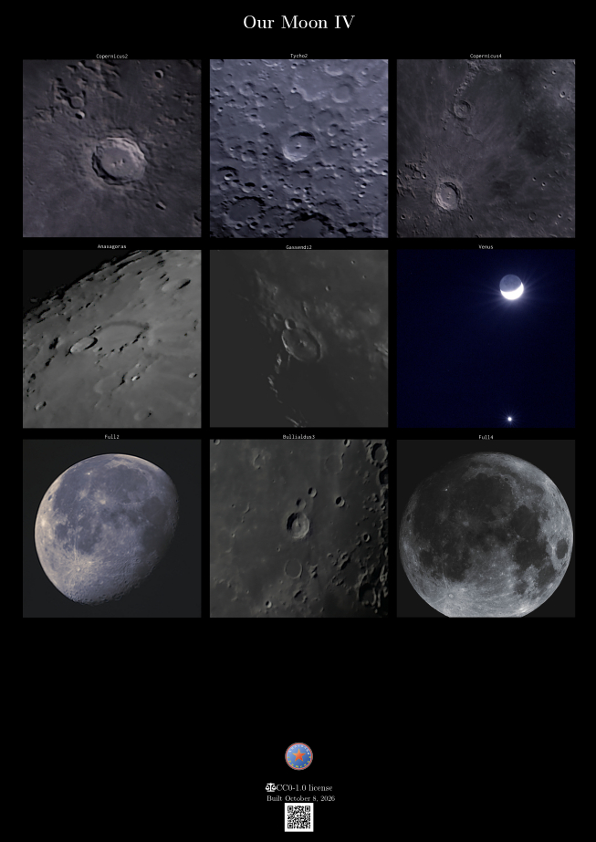 **Moon IV** [Download](https://github.com/Anatoli-Grishenko/Alexandreia/releases/download/The_Shelf/Moon_IV_US_A3.pdf)  1 A3-Pages. English.|

# Smartphone wallpapers

| | | | |
| :---: |:---: |:---: |:---: |
|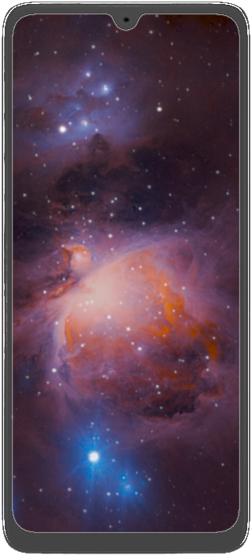 **Great Orion Nebula** [Download](https://github.com/Anatoli-Grishenko/Alexandreia/releases/download/The_Shelf/Orion_Running_Mairan_Nebula+sm.jpg) [What is this?](https://github.com/Anatoli-Grishenko/Astrophotography/blob/master/Stories/Orion_Nebula.md)|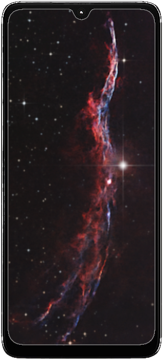 **West Veil Nebula** [Download](https://github.com/Anatoli-Grishenko/Alexandreia/releases/download/The_Shelf/West_Veil_Nebula+sm.jpg) [What is this?](https://github.com/Anatoli-Grishenko/Astrophotography/blob/master/Stories/West_Veil_Nebula.md)|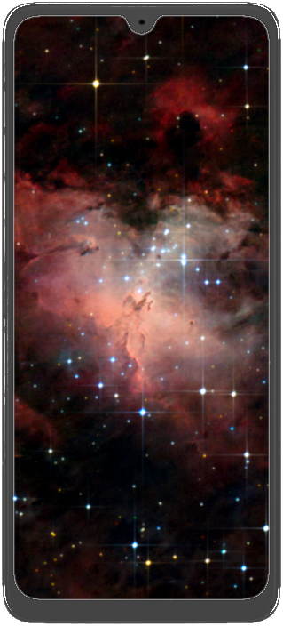 **Eagle Nebula** [Download](https://github.com/Anatoli-Grishenko/Alexandreia/releases/download/The_Shelf/Eagle_Nebula+sm.jpg) [What is this?](https://github.com/Anatoli-Grishenko/Astrophotography/blob/master/Stories/Eagle_Nebula.md)|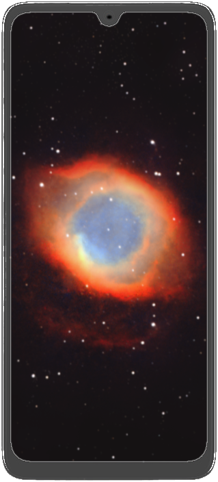 **Helix Nebula** [Download](https://github.com/Anatoli-Grishenko/Alexandreia/releases/download/The_Shelf/Helix_Nebula+sm.jpg) [What is this?](https://github.com/Anatoli-Grishenko/Astrophotography/blob/master/Stories/Helix_Nebula.md)|

