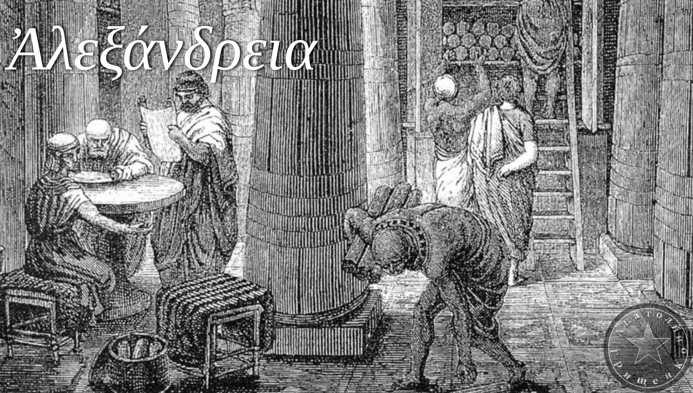 [Image Credits](https://en.wikipedia.org/wiki/Library_of_Alexandria#/media/File:Ancientlibraryalex.jpg)

Welcome to my particular, and very personal, Library of Alexandria. I will leave here EPUBs, PDFs, JPGs, ... whatever publication means is fine to me. I write about my thoughts, my Astrophotography activity, my research on Humanism, code, or whatever I connsider worth sharing. Please feel yourself at home and take whatever you want. Everything is free under Creative Commons Licence. [Leer en Español](./LEEME.md)

# Astropedia Series

My astrophotography activity dressed with some personal thoughts.

| | | | |
| :---: |:---: |:---: |:---: |
|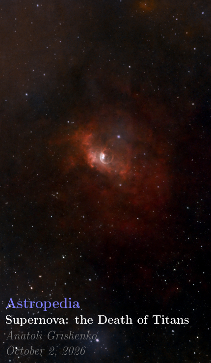 **Supernova: The Death of titans** [Download](https://github.com/Anatoli-Grishenko/Alexandreia/releases/download/The_Shelf/Supernova_US.pdf)  40 Pages. English.|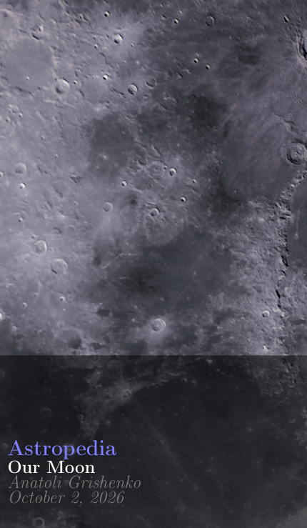 **Our Moon** [Download](https://github.com/Anatoli-Grishenko/Alexandreia/releases/download/The_Shelf/OurMoon_US.pdf)  100 Pages. English.|||

# Sacred Geometry Series

A journey for the history of the human beings which show how its evolution required the development of some sort of algebraic knowledge. Different civilizations, even in opposite sides of Earth, but same algebraic solutions.

## Origins

(AI-generated summary) These three e-books reflect on how mathematics, geometry, and astronomy underpin reality and have guided the development of human civilizations. Through a historical and mathematical lens, they examine the evolution of *Homo sapiens*, highlighting that our most significant distinguishing trait is mutual care and social cohesion in the face of adversity. Furthermore, they explore fundamental concepts such as the "1:2:3" creative principle and sacred geometry, which appear both in the natural world and across various cultures.

| | | | |
| :---: |:---: |:---: |:---: |
|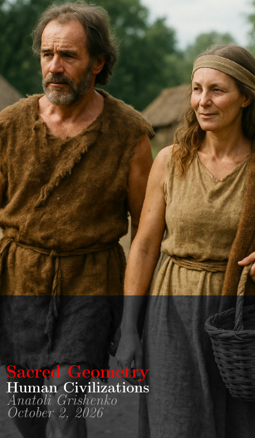 **Human Civilizations** [Download](https://github.com/Anatoli-Grishenko/Alexandreia/releases/download/The_Shelf/Civilizations_US.pdf)  40 Pages. English.|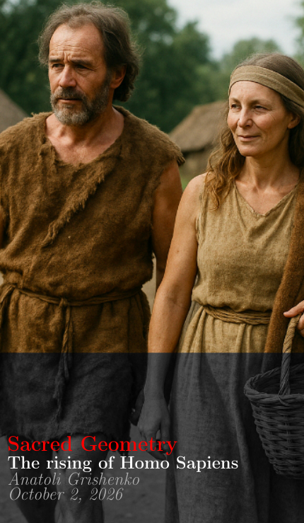 **The Rising of Homo Sapiens** [Download](https://github.com/Anatoli-Grishenko/Alexandreia/releases/download/The_Shelf/RisingSapiens_US.pdf)  34 Pages. English.| **The Epiphany** [Download](https://github.com/Anatoli-Grishenko/Alexandreia/releases/download/The_Shelf/TheEpiphany_US.pdf)  41 Pages. English.||

## Dynastic Egypt

(AI-generated summary) These three e-books explore how the scribes and priests of ancient Egypt developed practical mathematics and geometry. Drawing on problems from the Rhind Papyrus, the text examines the efficient distribution of food using unit fractions, as well as the measurement of farmland following the flooding of the Nile. Furthermore, it analyzes the creation of the solar calendar and the precision involved in the geometric and astronomical alignment of the Giza pyramids.

| | | | |
| :---: |:---: |:---: |:---: |
|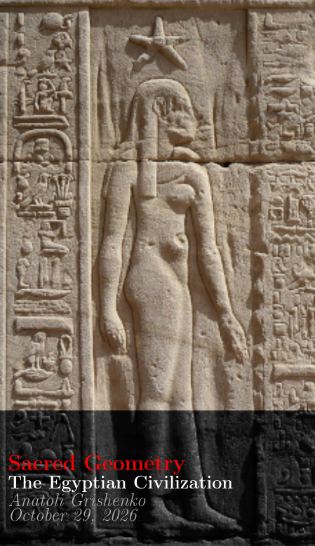 **The Egyptian Civilization** [Download](https://github.com/Anatoli-Grishenko/Alexandreia/releases/download/The_Shelf/Egyptian_Civilizations_US_EBook.pdf)  18 Pages. English.|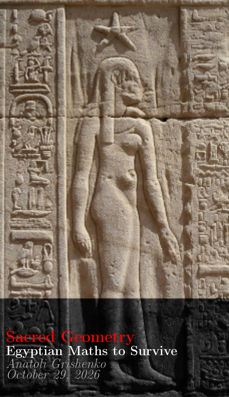 **Egyptian Maths to Survive** [Download](https://github.com/Anatoli-Grishenko/Alexandreia/releases/download/The_Shelf/Egyptian_Maths_US_EBook.pdf)  34 Pages. English.|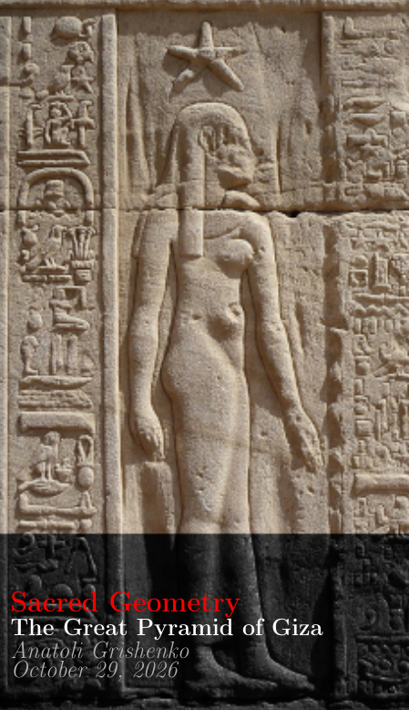 **The Great Pyramid of Giza** [Download](https://giub.com/Anatoli-Grishenko/Alexandreia/releases/download/The_Shelf/Egypt_Giza_US_EBook.pdf)  24 Pages. English.||

### Fables Sacred Geometry

Fables are kind of a tiny lecture which transport the reader to an ancient place or time in History in order to provide a proper context for the upcoming episodes of the series.

| | | | |
| :---: |:---: |:---: |:---: |
|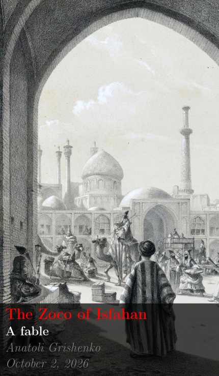 [Download](https://github.com/Anatoli-Grishenko/Alexandreia/releases/download/The_Shelf/Fable_Zoco_Isfahan_US.pdf) **The Zoco of Isfahan**  16 pages English.|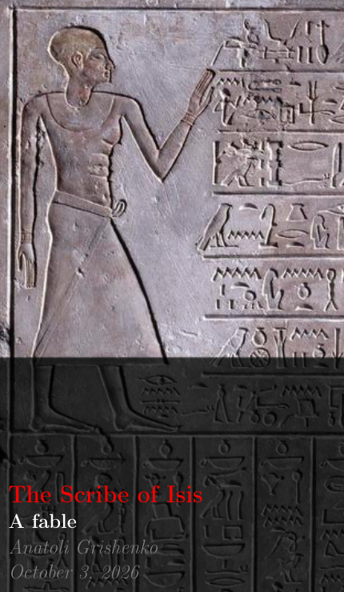 [Download](https://github.com/Anatoli-Grishenko/Alexandreia/releases/download/The_Shelf/FableIsis_US.pdf) **The Temple of Isis**  14 pages English.|||

# Mathematical background

The formulae which describe everything

| | | | |
| :---: |:---: |:---: |:---: |
|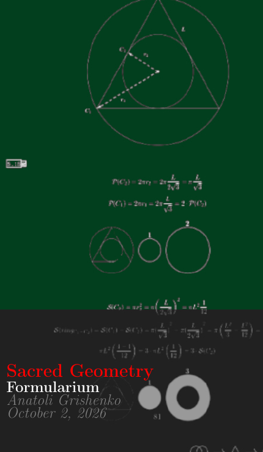 **The Formularium** [Download](https://github.com/Anatoli-Grishenko/Alexandreia/releases/download/The_Shelf/Formularium_US.pdf)  60 Pages. English.||||

# A3 Posters Nebulae

| | | |
| :---: |:---: |:---: |
|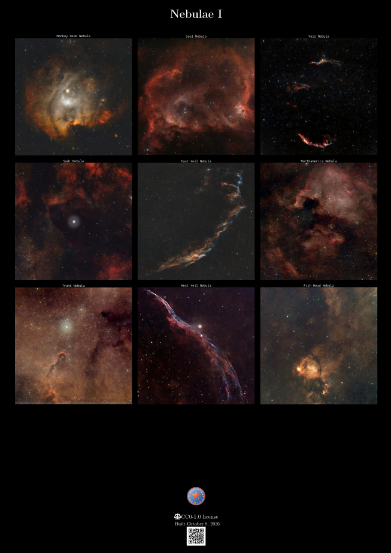 **Nebulae I** [Download](https://github.com/Anatoli-Grishenko/Alexandreia/releases/download/The_Shelf/Nebulae_I_US_A3.pdf)  1 A3-Pages. English.|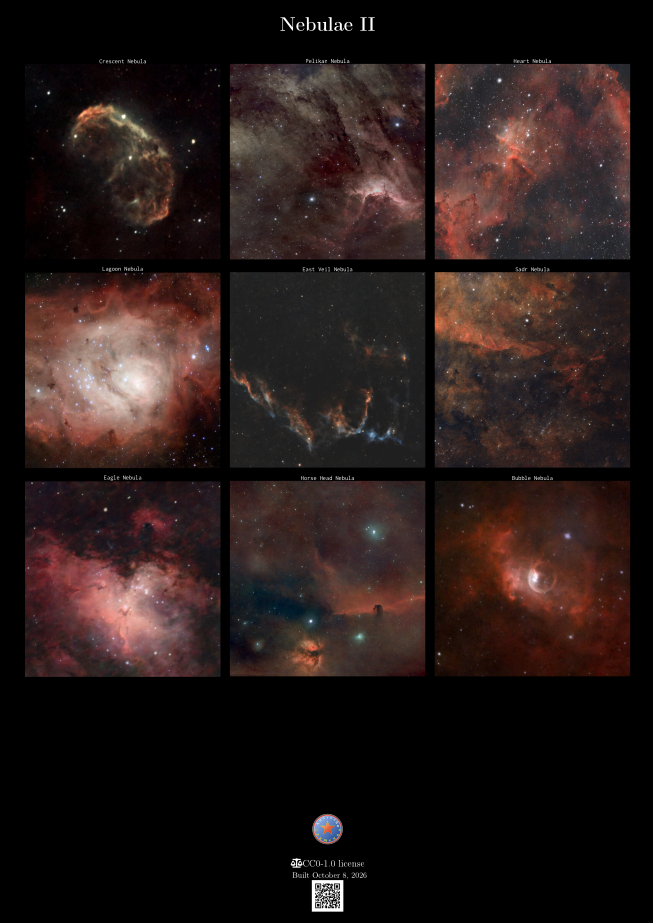 **Nebulae II** [Download](https://github.com/Anatoli-Grishenko/Alexandreia/releases/download/The_Shelf/Nebulae_II_US_A3.pdf)  1 A3-Pages. English.|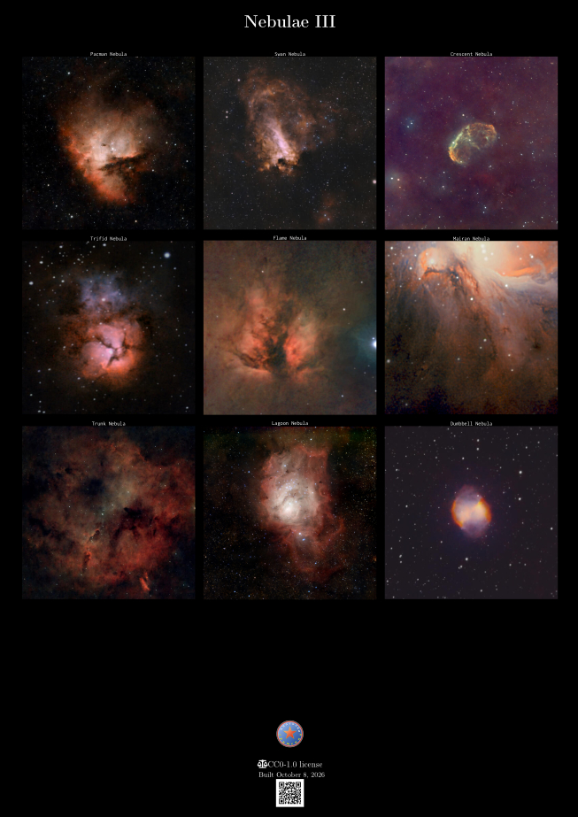 **Nebulae III** [Download](https://github.com/Anatoli-Grishenko/Alexandreia/releases/download/The_Shelf/Nebulae_III_US_A3.pdf)  1 A3-Pages. English.|
|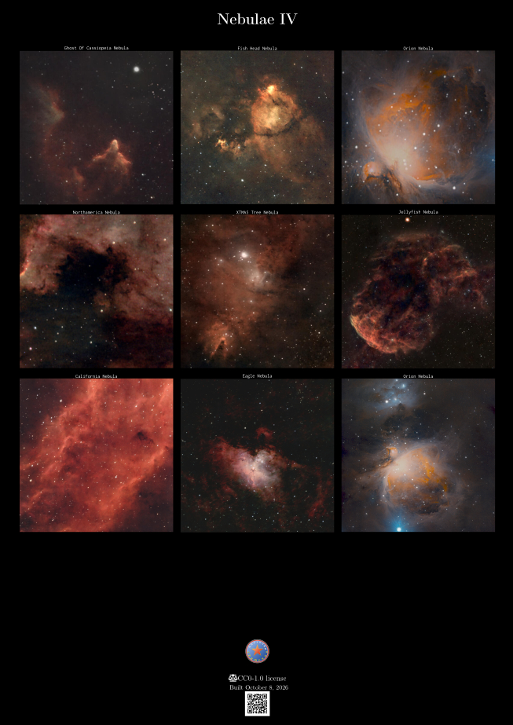 **Nebulae IV** [Download](https://github.com/Anatoli-Grishenko/Alexandreia/releases/download/The_Shelf/Nebulae_IV_US_A3.pdf)  1 A3-Pages. English.|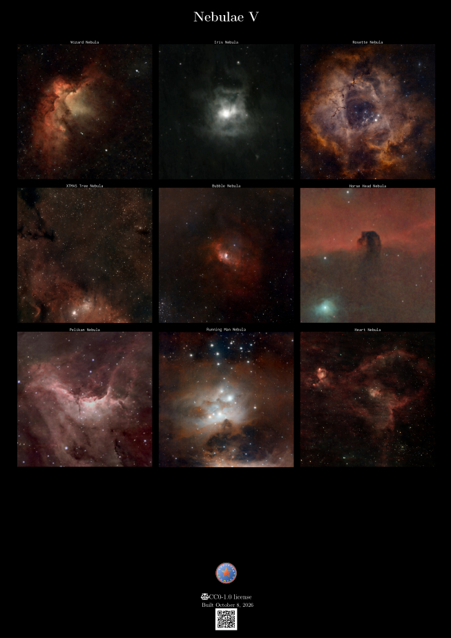 **Nebulae V** [Download](https://github.com/Anatoli-Grishenko/Alexandreia/releases/download/The_Shelf/Nebulae_V_US_A3.pdf)  1 A3-Pages. English.|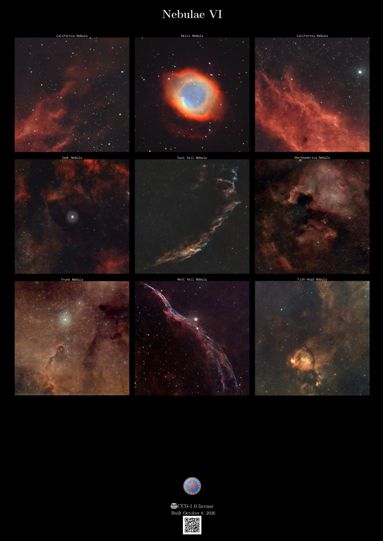 **Nebulae VI** [Download](https://github.com/Anatoli-Grishenko/Alexandreia/releases/download/The_Shelf/Nebulae_VI_US_A3.pdf)  1 A3-Pages. English.|

# A3 Posters Moon

| | | | |
| :---: |:---: |:---: |:---: |
|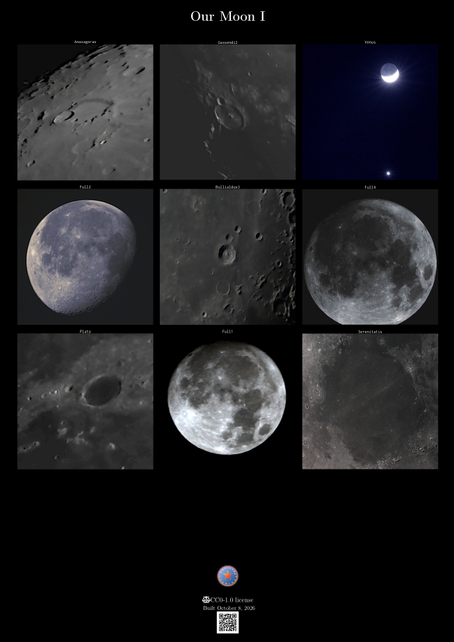 **Moon I** [Download](https://github.com/Anatoli-Grishenko/Alexandreia/releases/download/The_Shelf/Moon_I_US_A3.pdf)  1 A3-Pages. English.|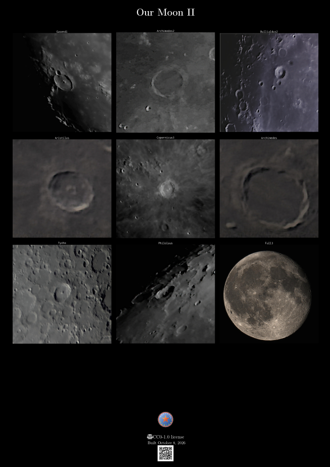 **Moon II** [Download](https://github.com/Anatoli-Grishenko/Alexandreia/releases/download/The_Shelf/Moon_II_US_A3.pdf)  1 A3-Pages. English.|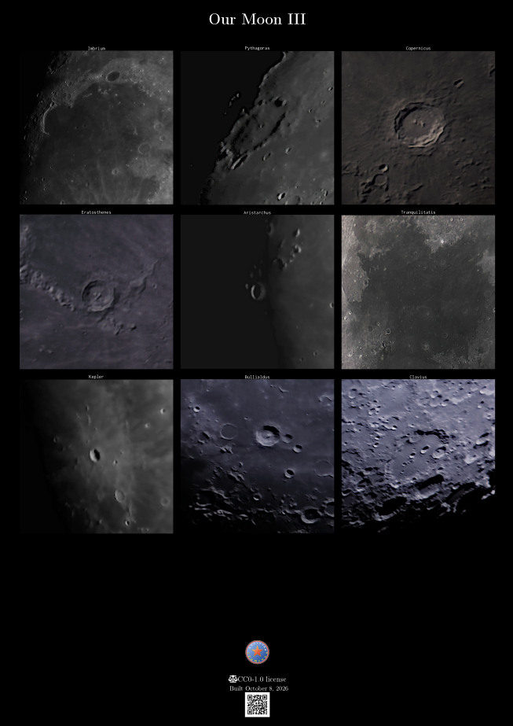 **Moon III** [Download](https://github.com/Anatoli-Grishenko/Alexandreia/releases/download/The_Shelf/Moon_III_US_A3.pdf)  1 A3-Pages. English.|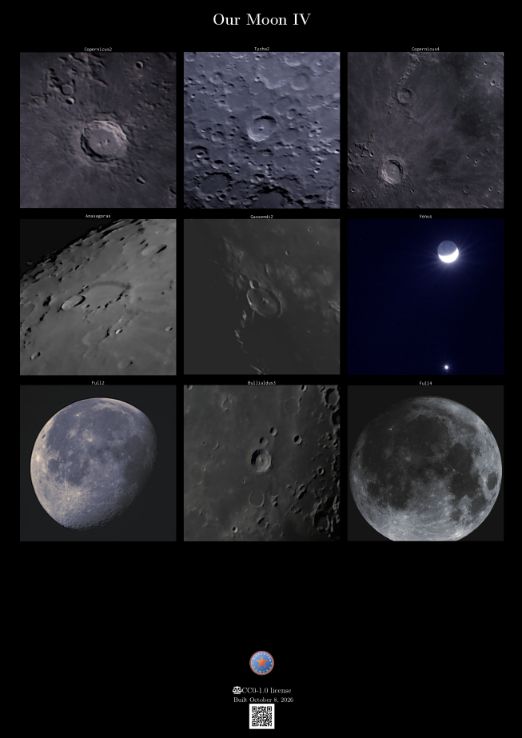 **Moon IV** [Download](https://github.com/Anatoli-Grishenko/Alexandreia/releases/download/The_Shelf/Moon_IV_US_A3.pdf)  1 A3-Pages. English.|

# Smartphone wallpapers

| | | | |
| :---: |:---: |:---: |:---: |
|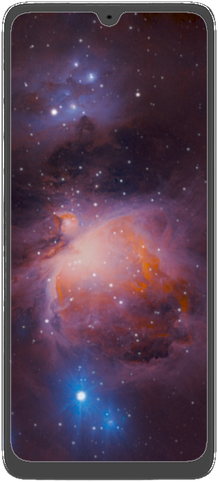 **Great Orion Nebula** [Download](https://github.com/Anatoli-Grishenko/Alexandreia/releases/download/The_Shelf/Orion_Running_Mairan_Nebula+sm.jpg)||||

